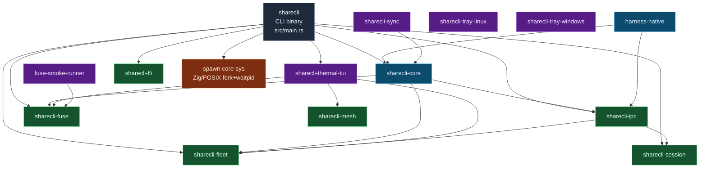

# 01 — System overview (crate topology)

This diagram shows the runtime crate topology of sharecli. The
goal is to answer "where does this functionality live?" in one
glance.

## Reading the diagram

- **Blue (core)**: `sharecli-core` is the central state machine,
  resource manager, and process-pool. The CLI binary depends on
  it for every state-mutating operation. `harness-native` is
  the per-OS harness detection lib and is a thin wrapper around
  `sharecli-core`.
- **Green (adapter)**: adapters wrap I/O and external systems.
  - `sharecli-ffi` — C-ABI surface for the sharecli-fleet
    aggregator and third-party languages.
  - `sharecli-fleet` — multi-device fleet registry, thermal
    aggregation, and the contract-capture surface.
  - `sharecli-ipc` — NDJSON-RPC over Unix socket / Windows
    named pipe, plus the zmx session transport.
  - `sharecli-session` — durable terminal layout snapshots and
    session ledger (FR-005).
  - `sharecli-fuse` — FUSE mount + CoW + write-provenance xattr
    (FR-009).
  - `sharecli-mesh` — gossip / shared substrate protocol
    (FR-010).
- **Purple (ui)**: presentation-layer crates. None of them are
  required by the CLI binary; they import it instead.
  - `sharecli-sync`, `sharecli-tray-linux`, `sharecli-tray-windows`
    — desktop tray icons and the sync surface.
  - `sharecli-thermal-tui` — terminal UI for the thermal gate
    (FR-011).
  - `fuse-smoke-runner` — minimal test harness for the FUSE
    layer.
- **Orange (vendor)**: `spawn-core-sys` wraps a small Zig
  library that does POSIX `fork`+`waitpid` on Unix and a
  Rust stub on Windows. The CLI binary depends on it directly
  because `sharecli-core` is meant to be testable on Windows
  without a real spawn primitive.

## Why this shape

`sharecli-core` is the only crate that depends on more than
two other sharecli-* crates. It is the **port layer** in
ports-and-adapters terms. The adapter crates are independent
of `sharecli-core` and depend only on each other when there is
a hard technical reason (e.g. `sharecli-ipc` depends on
`sharecli-fleet` because the IPC transport needs the fleet
registry to resolve a peer by name).

The UI crates are leaves: they pull in core+adapters but no
adapter pulls them in. This keeps the CLI binary's compile
graph shallow on the inbound side (it only depends on the
ones it needs at runtime) and the adapter crates free of
UI-framework dependencies.

See [docs/adr/0007-ports-adapters-hexagonal.md](../../adr/0007-ports-adapters-hexagonal.md)
for the rationale behind this split.
