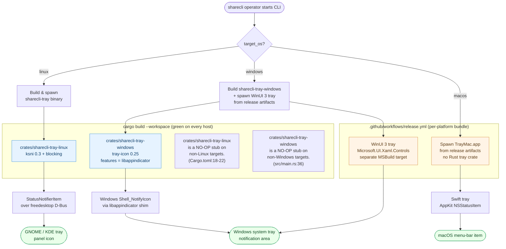

# sharecli tray platform matrix

sharecli ships a system-tray icon on all three target platforms, but
the tray stack is **not symmetric**. Linux is a single Rust crate that
talks StatusNotifierItem over D-Bus directly. Windows is **two**
things: the Rust `sharecli-tray-windows` crate (used as the
dev/CI/headless fallback) and a separately-built WinUI 3 tray that the
release workflow assembles. macOS is **only** a Swift / AppKit tray
that is built outside cargo entirely.

This diagram captures the routing matrix at the level of "what runs on
each platform and where the boundary is", so a contributor can answer:

- "Why does my Linux binary ship a tray but my Windows binary does
  not?"
- "Which crate do I patch to fix the tray icon on Linux?"
- "Where does the macOS .app come from?"

## Platform matrix

| Platform | Tray binary | Source location | Backend | Feature flag / build |
|----------|-------------|-----------------|---------|----------------------|
| Linux    | `sharecli-tray` | `crates/sharecli-tray-linux/` (Rust) | `ksni` 0.3 (StatusNotifierItem over D-Bus, blocking mode) | `[target.'cfg(target_os = "linux")'.dependencies] ksni = { version = "0.3", features = ["blocking"] }` (`crates/sharecli-tray-linux/Cargo.toml:22`). On non-Linux targets the binary is a no-op stub so `cargo build --workspace` stays green. |
| Windows  | `sharecli-tray-windows` (dev/CI) + WinUI 3 tray (release) | `crates/sharecli-tray-windows/` (Rust) + separate MSBuild target added by `.github/workflows/release.yml` | `tray-icon` 0.25 with `libappindicator` feature | `tray-icon = { version = "0.25", default-features = false, features = ["libappindicator"] }` (`crates/sharecli-tray-windows/Cargo.toml:14`). |
| macOS    | TrayMac.app (release only) | Xcode project, **not** in this repo | AppKit `NSStatusItem` | Added by `.github/workflows/release.yml` per `Cargo.toml:245-246` ("The macOS Swift tray and Windows WinUI 3 tray are assembled by separate steps in the workflow (they are not cargo crates)"). |

The same data is in flowchart form below.

## How to read this

- **The Cargo workspace never builds a tray on macOS.** No crate in
  `crates/` produces a macOS tray binary; `sharecli-tray-linux` is
  stubbed off-platform and `sharecli-tray-windows` is stubbed
  off-platform. A fresh `cargo build --workspace` on macOS produces
  `sharecli`, `sharecli-ipc`, `sharecli-tray` (the Linux stub) and
  nothing else. The macOS tray only appears in a release artifact
  produced by `.github/workflows/release.yml`.
- **Windows has two trays by design.** The Rust `sharecli-tray-windows`
  crate uses `tray-icon` with the `libappindicator` feature enabled
  (FR-007 AC-007.51/52/54). It is the dev/CI tray and the fallback for
  environments where the WinUI 3 build is not available. The WinUI 3
  tray is the user-facing release tray and is built separately.
- **Linux uses `ksni` blocking mode.** The `crates/sharecli-tray-linux`
  `Cargo.toml` enables the `blocking` feature (`Cargo.toml:22`) because
  the tray thread is the message loop — the lib's non-blocking API
  would require us to spin a Tokio reactor for the tray UI alone.
- **The cargo-dist release matrix is the source of truth for who
  ships what.** `Cargo.toml:247-260` lists
  `aarch64-apple-darwin, x86_64-apple-darwin, x86_64-unknown-linux-gnu,
  x86_64-pc-windows-msvc, aarch64-pc-windows-msvc`. The Linux tray is
  in the `app-local` install set; the macOS Swift tray and Windows
  WinUI 3 tray are added by the workflow, not by `cargo dist`.

## Cross-references

- [`01-system-overview.md`](01-system-overview.md) — where
  `sharecli-tray-linux` and `sharecli-tray-windows` sit in the 16-crate
  topology and which crate depends on them.
- `crates/sharecli-tray-linux/README.md` — the canonical user-facing
  description of the Linux tray's StatusNotifierItem surface.
- `Cargo.toml` lines 244-260 — the cargo-dist release configuration
  that determines what `cargo dist plan` emits for each platform.
- `.github/workflows/release.yml` — the workflow step that injects the
  Swift tray + WinUI 3 tray into the macOS / Windows artifacts.
- `FUNCTIONAL_REQUIREMENTS.md` — FR-007 AC-007.51, AC-007.52,
  AC-007.54 pin the cross-platform tray contract this matrix backs.