# sharecli clap-derive command dispatch

sharecli exposes ~25 top-level subcommands and ~80 nested subcommands
(`sharecli cast --help` prints them all). Every one of them reaches a
handler through the same pattern:

1. A `Cli` struct (`src/main.rs:59`) is derived with `#[derive(Parser)]`
   so `Cli::parse()` builds it from `argv`.
2. A nested `enum Commands` (`src/main.rs:88`) is derived with
   `#[derive(Subcommand)]` so each variant owns its `#[arg(...)]`
   schema.
3. The `match &cli.command` block in `async fn run()`
   (`src/main.rs:978-…`) maps each variant to either an inline
   statement (most top-level commands) or a deeper module dispatch
   (`Commands::Cast { cmd } => cast_cmd(cmd)?`, etc.).
4. Many variants carry a nested `#[command(subcommand)] cmd: SomeCmd`,
   which adds a second `enum` with `#[derive(Subcommand)]`. Those
   second-level enums (in `src/commands/<topic>.rs`) almost always
   delegate to a `pub fn run(...)` that returns `Result<()>`.

This diagram captures that pipeline from shell to handler. It is the
source of truth for "where do I add a flag?" and "why is my nested
subcommand showing up at the top level instead of inside its parent?".

```mermaid
flowchart TD
    Shell(["$ sharecli cast zmx send --session abc<br/>argv + env + working dir"]) --> Parse[Cli::parse<br/>src/main.rs:881]
    Parse --> Cli{cli.command<br/>enum Commands<br/>src/main.rs:88}

    Cli -- "Session { cmd }" --> SessionCmd[session_cmd<br/>nested SessionCmd enum]
    Cli -- "Surface { cmd }" --> SurfaceCmd[surface_cmd<br/>nested SurfaceCmd enum]
    Cli -- "Ps {...}" --> PsFn[ps project harness all json csv watch<br/>src/commands/mod.rs]
    Cli -- "Start {...}" --> StartFn[start project harness cwd args<br/>src/commands/mod.rs]
    Cli -- "Stop {...}" --> StopFn[stop pid project harness all force yes<br/>src/commands/mod.rs]
    Cli -- "Status {...}" --> StatusFn[status verbose json csv watch<br/>src/commands/mod.rs]
    Cli -- "Proc {...}" --> ProcFn[proc complex flag tree]
    Cli -- "Config { cmd }" --> ConfigCmd[config_cmd<br/>nested ConfigCmd enum<br/>src/commands/config_edit.rs]
    Cli -- "Pool {...}" --> PoolFn[pool_status shared runtime]
    Cli -- "CheckLimits {...}" --> CheckLimits[check_limits nested]
    Cli -- "SetLimits {...}" --> SetLimits[set_limits nested]
    Cli -- "RunPool {...}" --> RunPool[run_pool nested]
    Cli -- "Health {...}" --> HealthFn[health nested]
    Cli -- "Serve { cmd }" --> ServeCmd[serve_run<br/>nested ServeCmd enum<br/>src/commands/serve.rs]
    Cli -- "Cast { cmd }" --> CastCmd[cast_cmd<br/>nested CastCmd enum<br/>src/commands/cast.rs]
    Cli -- "Fuse { cmd }" --> FuseCmd[fuse_cmd<br/>nested FuseCmd enum<br/>src/commands/fuse.rs]
    Cli -- "Mesh { cmd }" --> MeshCmd[mesh_cmd<br/>nested MeshCmd enum<br/>src/commands/mesh.rs]
    Cli -- "Undo { cmd }" --> UndoCmd[undo_cmd nested]
    Cli -- "Soak { cmd }" --> SoakCmd[soak_cmd nested]
    Cli -- "Project { cmd }" --> ProjectCmd[project_cmd nested]
    Cli -- "Upgrade { cmd }" --> UpgradeCmd[upgrade_cmd nested]
    Cli -- "Uninstall { cmd }" --> UninstallCmd[uninstall_cmd nested]
    Cli -- "History {...}" --> HistoryFn[history nested]
    Cli -- "Report {...}" --> ReportFn[report nested]
    Cli -- "Help" --> HelpFn[cli_help prints cast/mesh/fuse/util subcommand tables<br/>src/main.rs:~1500]
    Cli -- "Version" --> VersionFn[cli_version ASCII splash + version<br/>src/main.rs:1555]

    SessionCmd --> SVC[sharecli_session::SessionService<br/>recovery / ledger / observation]
    SurfaceCmd --> Ghostty[GhosttyControlClient<br/>src/commands/cast.rs]
    CastCmd --> CastHandlers[cast subcommand handler table<br/>cast::run, zmx, hud, sni, …]
    FuseCmd --> FuseHandlers[fuse::run mount/unmount/xattr]
    MeshCmd --> MeshHandlers[mesh::run maildir / smart-merge]
    ProcFn --> ProcMod[src/commands/proc/*<br/>proc_scan, agent_inventory, host_watch]
    HealthFn --> HealthMod[Health → ThermalGovernor +<br/>HostResourceWatchJson]
    ServeCmd --> ServeMod[serve::run hyper / axum WS]
    ConfigCmd --> ConfigMod[config::ConfigCmd + ConfigCmdExec]

    %% Hypervisor coalesce boundary
    StartFn --> Hypervisor
    StopFn --> Hypervisor
    RunPool --> Hypervisor
    CheckLimits --> Hypervisor
    SetLimits --> Hypervisor
    Hypervisor[/"sharecli-ipc CoalesceCache<br/>see 05-ipc-cache-transaction-flow.md"/]

    classDef top fill:#e6f3ff,stroke:#3a8edb,color:#0b3b66;
    classDef nested fill:#fff4e6,stroke:#d68a3c,color:#5a3a14;
    classDef svc fill:#eaffea,stroke:#3aa86b,color:#0f4a23;
    classDef hl fill:#ffeaea,stroke:#c43a3a,color:#5a1414;
    class SessionCmd,SurfaceCmd,ConfigCmd,ServeCmd,CastCmd,FuseCmd,MeshCmd,UndoCmd,SoakCmd,ProjectCmd,UpgradeCmd,UninstallCmd nested;
    class SVC,Ghostty,CastHandlers,FuseHandlers,MeshHandlers,ProcMod,HealthMod,ServeMod,ConfigMod svc;
    class Hypervisor hl;
```

## How to read this

- **Cli is the root, Commands is the variant enum, every nested
  `#[command(subcommand)]` is another `enum` with its own
  `#[derive(Subcommand)]`.** clap derive generates the parser, the
  `--help`, the shell completion, and `clap_mangen` man pages from
  this schema. If you want a new flag, you add it to the struct /
  variant, **not** to a hand-written parser.
- **The `match &cli.command` block is the dispatch table.**
  `src/main.rs:978` is the canonical entry point. Most top-level
  commands call a function in `src/commands/<topic>.rs`; the ones that
  carry nested subcommands call a `*_cmd` shim that does the second
  `match`.
- **The "Cli::parse → run()" pipeline is async.** `run()` is an
  `async fn` (called from `#[tokio::main]` at `main.rs:856`). Most
  handler functions are also `async` (e.g. `async fn ps(...)`,
  `async fn status(...)`), but the cast / fuse / mesh / session
  families are sync because their work is local FS or short-lived
  RPC.
- **`Commands::Help` and `Commands::Version` are real variants.**
  They appear in the same enum and route to `cli_help` /
  `cli_version`. If you add a new variant, the auto-generated
  `sharecli --help` table picks it up via the `cli_help` walk over
  `cast_modules` / `mesh_modules` / `fuse_modules` / `util_modules`
  maps — those maps are populated in the corresponding `*_cmd`
  functions at startup time.

## Manifests seen in code

| Pattern | File | Lines |
|---------|------|-------|
| `#[derive(Parser)]` on root struct | `src/main.rs` | 59 |
| `#[derive(Subcommand)] enum Commands` | `src/main.rs` | 87-88 |
| `match &cli.command` dispatch table | `src/main.rs` | 978-… |
| `#[tokio::main]` async runtime | `src/main.rs` | 856 |
| `Commands::Help` / `cli_help` | `src/main.rs` | 1500-1549 |
| `Commands::Version` / `cli_version` | `src/main.rs` | 1552-1584 |
| `Commands::Config { cmd }` → nested enum | `src/commands/config_edit.rs` | top of file |
| `Commands::Serve { cmd }` → nested enum | `src/commands/serve.rs` | top of file |
| `Commands::Cast { cmd }` → nested enum | `src/commands/cast.rs` | top of file |
| `Commands::Fuse { cmd }` → nested enum | `src/commands/fuse.rs` | top of file |
| `Commands::Mesh { cmd }` → nested enum | `src/commands/mesh.rs` | top of file |

## Cross-references

- [`02-process-lifecycle.md`](02-process-lifecycle.md) — the
  `Commands::Start` / `Commands::Stop` / `Commands::Ps` data flow
  through this dispatch layer.
- [`05-ipc-cache-transaction-flow.md`](05-ipc-cache-transaction-flow.md)
  — the CoalesceCache the `Hypervisor::run` path drops into for
  start / stop / run-pool.
- `src/commands/mod.rs` — the home of `pool_status`, `set_limits`,
  `run_pool`, `start`, `ps`, `stop`, `status`, `health`. Every
  handler in this file shares the `SHARED_RUNTIME`
  `std::sync::OnceLock<SharedRuntime>` static.
- `docs/CLI_EXAMPLES.md` (added by the 4h-queue lane) — a
  complement to `--help` that pins the canonical invocation forms.
- `FUNCTIONAL_REQUIREMENTS.md` — FR-007 pins the operator output
  contract (`--json`, `--csv`, `--watch`) that the top-level
  variants expose uniformly.